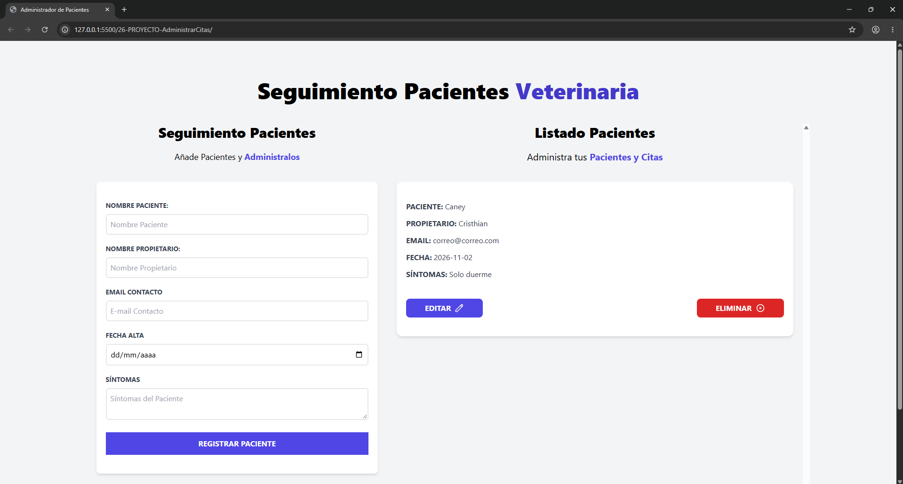

# 🐾 Administrador de Citas Veterinarias

Aplicación web desarrollada con **HTML5, CSS3 y JavaScript** que permite gestionar el seguimiento de pacientes de una veterinaria mediante el registro, visualización, edición y eliminación de citas.

El proyecto utiliza **IndexedDB** para almacenar la información directamente en el navegador, permitiendo conservar los registros incluso después de recargar la página.

Este desarrollo forma parte de mi aprendizaje de JavaScript y está enfocado en la práctica de programación orientada a objetos, manipulación del DOM y almacenamiento de datos en el navegador.

## 🚀 Demo

🔗 [Ver aplicación en GitHub Pages](https://cristhianychr.github.io/administrador-citas-veterinaria-js/)

## 📸 Vista previa



## ✨ Funcionalidades

- **Registrar pacientes:** permite ingresar el nombre del paciente, propietario, correo electrónico, fecha y síntomas.
- **Validar formularios:** comprueba que todos los campos obligatorios estén completos.
- **Visualizar citas:** muestra los pacientes registrados en una lista dinámica.
- **Editar citas:** permite modificar la información de un paciente previamente registrado.
- **Eliminar citas:** permite eliminar registros de pacientes.
- **Almacenamiento persistente:** utiliza IndexedDB para guardar los registros en el navegador.
- **Notificaciones dinámicas:** muestra mensajes de éxito y error según las acciones realizadas.
- **Actualización de la interfaz:** refleja los cambios en el listado después de registrar, editar o eliminar una cita.

## 🛠️ Tecnologías utilizadas

- **HTML5:** estructura de la aplicación y formularios.
- **CSS3:** estilos y presentación visual.
- **Tailwind CSS:** diseño de la interfaz mediante clases utilitarias.
- **JavaScript (ES6+):** lógica de negocio y manipulación del DOM.
- **IndexedDB:** almacenamiento de información en el navegador.
- **Git y GitHub:** control de versiones y publicación del proyecto.

## 🧠 Conceptos de JavaScript aplicados

- Programación orientada a objetos mediante clases.
- Constructores, propiedades y métodos.
- Objetos y manipulación de propiedades.
- Manipulación del DOM y creación dinámica de elementos.
- Gestión de eventos con `addEventListener`.
- Validación y manejo de formularios.
- Métodos de objetos como `Object.values()`, `Object.assign()`, `Object.entries()` y `Object.fromEntries()`.
- Operador de propagación y encadenamiento opcional.
- Funciones flecha.
- Generación de identificadores únicos.
- Operaciones CRUD (Create, Read, Update, Delete).
- Manejo de transacciones y operaciones asíncronas con IndexedDB.

## 💾 Almacenamiento con IndexedDB

La aplicación utiliza IndexedDB como mecanismo de almacenamiento local.

Se implementa una base de datos denominada `citas`, que contiene un almacén de objetos (*Object Store*) llamado `citas`.

Cada registro almacena los siguientes datos:

- ID de la cita.
- Nombre del paciente.
- Nombre del propietario.
- Correo electrónico.
- Fecha.
- Síntomas.

La información se conserva en el navegador del usuario y no requiere una conexión a un servidor o una base de datos externa.

## 📂 Estructura del proyecto

```text
administrador-citas-veterinaria-js/
├── dist/
│   └── output.css
├── img/
│   └──preview.png
├── js/
│   └── app.js
├── index.html
├── .gitignore
└── README.md
```

## ⚙️ Instalación y ejecución

1. Clona el repositorio:

   ```bash
   git clone https://github.com/cristhianychr/administrador-citas-veterinaria-js.git
   ```

2. Accede a la carpeta:

   ```bash
   cd administrador-citas-veterinaria-js
   ```

3. Abre `index.html` en tu navegador.

No es necesario instalar dependencias adicionales ni configurar un servidor backend para ejecutar la aplicación.

## 📌 Aprendizajes

Este proyecto me permitió profundizar en el desarrollo de aplicaciones web utilizando JavaScript, especialmente en la implementación de operaciones CRUD y el almacenamiento persistente mediante IndexedDB.

También reforcé la programación orientada a objetos, la manipulación dinámica del DOM, la validación de formularios y la separación de responsabilidades mediante clases.

## 👨‍💻 Autor

Proyecto desarrollado como parte de mi formación práctica en JavaScript y desarrollo web.

Cristhian Chanamé
Estudiante de Ingeniería de Software.